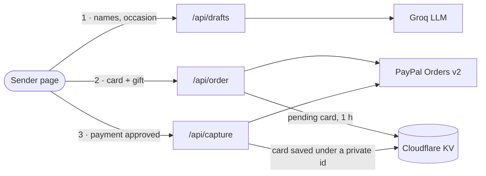
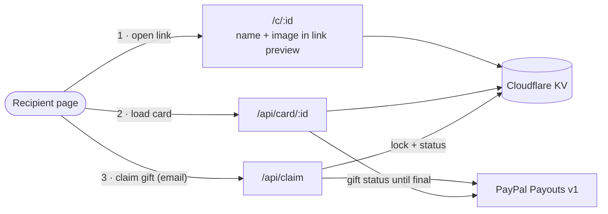

# Greetonata

**A greeting card where your words become a picture and a melody.**

Greetonata (*greeting* + *sonata*) turns a short message into a one-of-a-kind card. AI helps you write it,
the text itself decides what gets drawn and how the tune goes, and PayPal carries both the card and a cash gift
to the person you send it to.

**Live:** https://greetonata.pages.dev &nbsp;·&nbsp; Built for the PayPal AI Hackathon 2026

---

## What it does

1. **Pick an occasion.** Birthday, celebration, Christmas or thank you.
2. **Say who it's for.** Their name, your name, how you know each other and one detail about them.
3. **Choose your words.** The AI writes three drafts in different moods (warm, playful, festive). You pick one
   and edit it as much as you like.
4. **Watch it come alive.** The message is drawn as a cake, a flower, a snowflake or a heart, and a piano
   melody plays while each word lights up.
5. **Pay with PayPal.** The card costs $2.99, and you can add a gift of $10, $20 or $50.
6. **Send the link.** The recipient opens an envelope with a wax seal, hears the card, blows out the candles
   and claims the gift to their PayPal account.

## Why each card is different

The same message always gives the same card, and a different message gives a different one. Nothing is random.

| From the message | Becomes |
| --- | --- |
| Occasion | The family of shapes: cakes, 9 real flowers, 7 real snowflake types, 6 kinds of hearts |
| A fingerprint of the text (letters, length, rhythm of words) | Which shape, its colours and every small detail of how it is drawn |
| An age written in the text ("30th", "eighteen", "twenty-one") | Candles shaped as that number on the cake |
| The recipient's name | The opening notes. Each letter maps to a note, so *Ana* and *Maja* start differently |
| The sender's name | The closing notes |
| The mood of the chosen draft | Waltz in 3/4 (warm), swing in 4/4 (playful) or 4/4 with a closing flourish (festive) |
| Number of words | Song length: 8 bars, or 12 for longer messages |

### What the AI adds

For each draft, the AI (Groq) also returns:

- **Key words.** The words that matter most. They are played louder, with a deeper bass note and extra sparkle.
- **A palette.** Up to three colours that fit the message, used to tint the shape and the sparkles.
- **Energy (1–5).** This nudges the tempo.

The server checks everything the AI sends back. Key words must really appear in the text, colours must be valid
hex codes, and energy is kept between 1 and 5. If anything is missing, the card still works from the text alone.

## How it works

Both pages share the same card engine in the browser (`js/shapes.js`, `js/music.js`, `js/draw.js`), so the
recipient sees and hears exactly what the sender saw.

**Sending a card**



**Opening a card**



### The payment and gift flow

1. **`/api/order`** checks the card, works out the total on the server (the browser never sets the price),
   creates a PayPal order with line items, and keeps the card in KV for one hour under `pending:<orderId>`.
2. The sender approves the payment in the PayPal buttons.
3. **`/api/capture`** captures the order and checks that the amount PayPal took matches the card. It then saves
   the card under a new private id (`card:<id>`) and deletes the pending entry, so one payment can't create two
   cards. The sender gets a receipt with the PayPal transaction id.
4. The recipient opens `/c/<id>`. That route adds the recipient's name and an occasion image to the link
   preview, so it looks right in WhatsApp, iMessage and similar apps.
5. **`/api/claim`** sends the gift with PayPal Payouts. Before paying, it locks the card, and it uses
   `sender_batch_id = greetonata-<id>`, so PayPal itself refuses a second payout for the same card.
6. **`/api/card/:id`** asks PayPal for the payout status until it is final. The recipient then sees "on its way",
   "waiting in PayPal, sign in to accept it", "arrived" or "went back to the sender", instead of a guess.

### Protection

- **Rate limits** for each IP address: drafts 10 per 10 min, orders 8 per 10 min, captures 20 per 10 min,
  claims 6 per 10 min, opening a card 60 per minute. When a limit is reached, the API answers `429`.
- **Prices come only from the server.** It accepts a fixed set of gift amounts, and the capture is checked
  against the order.
- **Secrets stay on the server.** The PayPal secret and the Groq key are Cloudflare environment variables.
  The browser only sees the public PayPal client id.
- **Errors are kept private.** Details from the AI and PayPal go to the server log, and the browser gets a
  plain message.

## Project layout

```
index.html            sender: occasion → names → AI drafts → card preview → PayPal → link
card.html             recipient: envelope → card + melody → wish → gift
js/shapes.js          text fingerprint, colours, flowers, snowflakes, hearts, cakes
js/music.js           melody from the message and the names, piano sampler
js/draw.js            painting a shape over time, sparkles, candles
js/desk.js            wide screens: program notes and a live score beside the card
functions/api/        drafts, order, capture, card, claim, config, _shared (helpers)
functions/c/[id].js   card link with its own preview title and image
og/                   link preview images, one per occasion
piano/                Salamander Grand Piano samples (CC BY 3.0)
tests/                server and engine tests (node --test)
```

No framework and no build step. The site is plain HTML, CSS and JavaScript, and the server is a handful of
Cloudflare Pages Functions.

## Accessibility

- Each card drawing has a spoken description, for example *"Card for Ana: A strawberry birthday cake with
  candles shaped as 30, drawn while a piano melody plays."*
- The message is real text, so screen readers can read it.
- Candles can be blown out with a button as well as by tapping, so a keyboard or screen reader works too.
- When the system setting *Reduce motion* is on, sparkles, floating notes, gliding scroll and CSS animations
  are turned off.

## Run it yourself

You need a Cloudflare account, a PayPal developer account (sandbox) and a Groq API key.

1. **Fork this repository** and create a Cloudflare Pages project from it. There is no build command, and the
   output directory is `/`.
2. **Create a KV namespace** and bind it to the Pages project as **`CARDS`**.
3. **Add environment variables** in the Pages project settings:

   | Name | Value |
   | --- | --- |
   | `GROQ_API_KEY` | Your Groq API key |
   | `PAYPAL_CLIENT_ID` | Client ID of a PayPal **sandbox** REST app |
   | `PAYPAL_SECRET` | Secret of the same app (mark it as encrypted) |

4. In the PayPal developer dashboard, make sure the sandbox app has **Payouts** enabled.
5. Deploy. The app uses the PayPal sandbox only, so no real money moves.

Run the tests (Node 18 or newer, nothing to install):

```bash
npm test
```

The tests use a fake PayPal, a fake Groq and an in-memory KV store. They cover drafts, rate limits, ordering,
capture (including a double capture), claiming a gift once, payout status, and the card engine (same message →
same tune, name-based openings, cake candles, shape choice, screen-reader descriptions).

## Try it as a judge

Use the PayPal **sandbox** test accounts listed in the Devpost submission. One account pays for the card, and
the other receives the gift. Pick any amount; it is test money.

## Built with

Cloudflare Pages and Pages Functions · Cloudflare KV · Groq (Llama 3.3 70B, falling back to other models on
the account) · PayPal Orders v2 · PayPal Payouts v1 · PayPal JavaScript SDK · Web Audio API · Canvas 2D ·
HTMLRewriter

## Credits

- Piano: [Salamander Grand Piano V3](https://archive.org/details/SalamanderGrandPianoV3) by Alexander Holm,
  CC BY 3.0
- Fonts: [Cormorant Garamond](https://fonts.google.com/specimen/Cormorant+Garamond) and
  [DM Sans](https://fonts.google.com/specimen/DM+Sans), SIL Open Font License

## License

[MIT](LICENSE)
